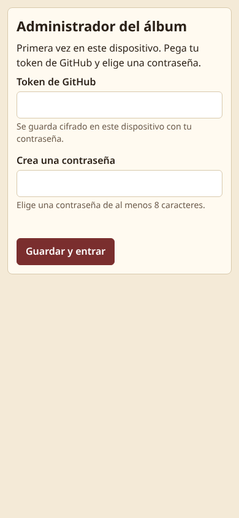
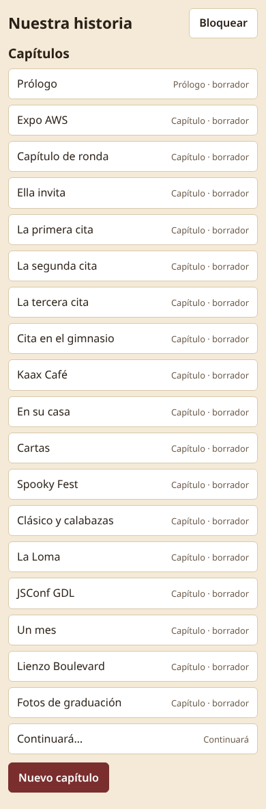
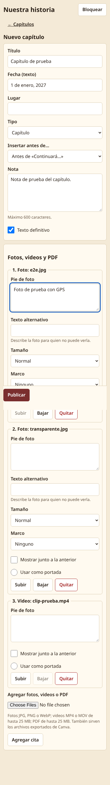
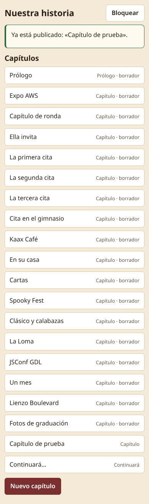
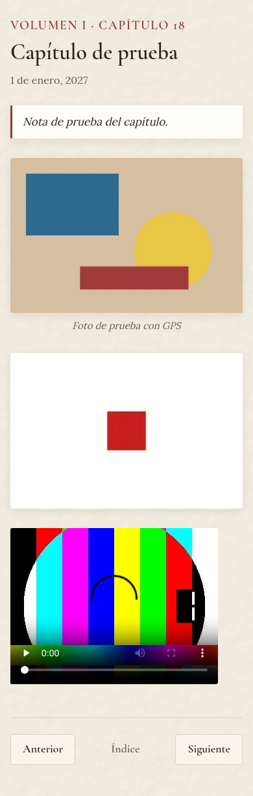
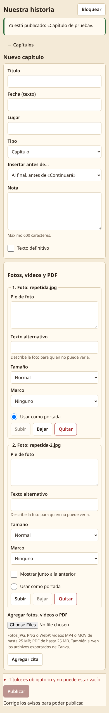
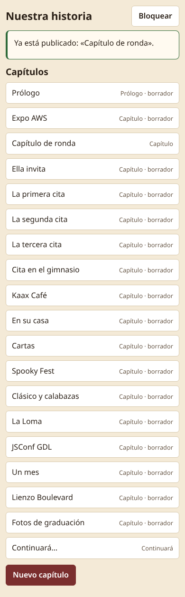

# Guía de Angel

Esta guía explica cómo agregar y cambiar capítulos del álbum "Nuestra historia" sin ayuda de nadie. Todo se hace desde el celular o la computadora, con el navegador. No necesitas instalar nada.

> Nota sobre las capturas: todas las imágenes de esta guía vienen de una copia local de prueba, no del álbum real. Los textos y datos que se ven son de ejemplo, y tu pantalla puede verse un poco distinta.

## 1. Preparación (una sola vez)

1. Crea una cuenta en GitHub y un repositorio **privado** para el álbum.
2. Crea una cuenta en Cloudflare Pages y conéctala a ese repositorio. Los pasos exactos están en `docs/DEPLOY.md`.
3. Crea un token de GitHub. En GitHub: Settings → Developer settings → Fine-grained tokens. Dale acceso solo a este repositorio, con permiso `Contents: Read and write` y `Actions: Read-only`. Guarda el token en un lugar seguro. Se muestra una sola vez.
4. Abre `content/site.json` en la página web de GitHub (botón del lápiz) y revisa que el campo `repo` tenga tu usuario (`owner`) y el nombre del repositorio (`name`). Si dice `REPLACE_WITH_...`, cámbialo y guarda (commit). Mientras diga `REPLACE_`, el administrador mostrará: "Configura el repositorio".

Nada de esto se hace con línea de comandos. Todo es con la página web de GitHub.

## 2. Abrir el administrador: token y contraseña

1. Abre la dirección del álbum y agrega `/admin/` al final. Ejemplo: `https://tu-album.pages.dev/admin/`.
2. La primera vez en cada dispositivo verás "Primera vez en este dispositivo". Pega tu **token de GitHub** y crea una **contraseña** de al menos 8 caracteres. Toca "Guardar y entrar".
3. Las siguientes veces solo escribes la contraseña y tocas "Entrar".
4. El token se guarda cifrado en ese dispositivo. Toca "Bloquear" cuando termines.
5. Si quieres quitar el token de un dispositivo, toca "Olvidar este dispositivo".



## 3. Agregar un capítulo

1. En la lista de capítulos, toca "Nuevo capítulo".


2. Escribe el **Título** y la **Fecha**. Lugar y Nota son opcionales.
3. Sube las fotos y los videos. Puedes elegirlos desde el celular o la computadora.
4. En cada elemento puedes escribir un texto (pie de foto), subirlo o bajarlo para cambiar el orden, o quitarlo. También puedes agregar una cita con "Agregar cita".
5. Elige la **Portada** del capítulo.
6. Toca "Publicar".
7. El administrador te avisa cuándo estará listo. El sitio se reconstruye solo y tarda unos minutos. Después de eso, el capítulo aparece en el índice del álbum.



Al terminar aparece "Ya está publicado" y el capítulo nuevo queda en la lista, justo antes de "Continuará…". En la lista, "borrador" marca los capítulos con texto todavía no definitivo; en estas capturas de prueba casi todos lo son.





Si falta algo obligatorio, por ejemplo el título, el administrador lo dice en español y deja "Publicar" desactivado hasta que lo corrijas. Si subes dos archivos con el mismo nombre, el segundo se renombra solo (`repetida.jpg` y `repetida-2.jpg`) para que no se pisen:



Después de editar y publicar un capítulo existente, la lista de capítulos muestra el aviso "Ya está publicado" con el nombre del capítulo:



Para editar un capítulo, tócalo en la lista, cambia lo que quieras y toca "Publicar". Para borrarlo, toca "Eliminar capítulo".

La dirección del NFC no cambia nunca, aunque agregues, edites o borres capítulos.

## 4. Agregar el capítulo del 28 de noviembre

Hay dos formas. Elige una:

- **Editar "Continuará".** Abre el capítulo "Continuará" en la lista, cambia el título a lo que quieras, la fecha a 28 de noviembre, agrega las fotos y publica. Así el final del álbum se convierte en el capítulo del 28 de noviembre.
- **Insertar antes de "Continuará".** Toca "Nuevo capítulo", llena título, fecha (28 de noviembre) y fotos. En "Insertar antes de…" elige "Antes de «Continuará…»" y publica. El capítulo queda entre el último capítulo y "Continuará", toma el número siguiente al último capítulo, y los capítulos anteriores conservan su número.

Después de publicar, abre el álbum y revisa que el capítulo se vea bien.

## 5. Cambiar el título del álbum

El título del álbum ("Nuestra historia") no se cambia desde el administrador. Se cambia en GitHub:

1. Entra a GitHub, a tu repositorio, y abre la carpeta `content`, luego el archivo `site.json`.
2. Toca el ícono del lápiz (Edit).
3. Cambia el texto de `title`. Ejemplo: `"title": "Nuestra historia"`. Deja las comillas y la coma.
4. Toca "Commit changes" y confirma.
5. Espera la reconstrucción del sitio, unos minutos. Puedes verla en la pestaña "Actions" del repositorio. Debe terminar con una palomita verde.
6. Abre el álbum y recarga la página.

Si ves en el administrador "Configura el repositorio" o las publicaciones no llegan al repositorio correcto, revisa en el mismo archivo `site.json` el campo `repo`:

```json
"repo": { "owner": "tu-usuario-de-github", "name": "nombre-del-repositorio", "branch": "main" }
```

`owner` es tu usuario de GitHub, `name` es el nombre del repositorio y `branch` debe ser `main`. No dejes ningún texto que diga `REPLACE_`. Guarda con "Commit changes".

Cuidado con las comillas y las comas. Si el sitio deja de construirse después de tu cambio, mira la sección de problemas más abajo ("Deshacer un cambio").

## 6. Exportar de Canva y subir

1. En Canva, toca Compartir → Descargar.
2. Elige **PNG** o **JPG** para páginas como imagen (sirve para fotos y collages), **PDF** para varias páginas, o **MP4** para video.
3. Descarga el archivo.
4. En el administrador, crea o abre un capítulo y sube el archivo como cualquier otra foto, PDF o video.

El administrador acepta imágenes, PDF y MP4 de Canva.

## 7. Consejos para videos

- Máximo **25 MB** por video y **120 segundos** de duración. Si pasa, el administrador lo rechaza y te dice el límite.
- Si pesa más de **12 MB**, te avisa que puede tardar en subir. Lo ideal es menos de 12 MB.
- Formatos: MP4, MOV o M4V.
- Para que pese menos: graba más corto, o usa una app para comprimir el video antes de subirlo (en el celular, o en la computadora con una herramienta como HandBrake).
- Los PDF también tienen un máximo de 25 MB.
- Las fotos se aceptan en JPG, PNG o WebP. Las fotos HEIC no sirven: expórtalas como JPG o PNG antes.
- Máximo 40 archivos por publicación.
- Las fotos muy grandes se comprimen solas cuando se reconstruye el sitio.

## 8. Si algo sale mal

**Olvidé mi contraseña.** La contraseña solo protege el token guardado en ese dispositivo. Toca "Olvidar este dispositivo", pega el token otra vez y crea una contraseña nueva. Tus capítulos no se pierden, están en GitHub.

**El token venció.** El administrador dirá que el token no sirve. Crea uno nuevo en GitHub (Settings → Developer settings → Fine-grained tokens), toca "Olvidar este dispositivo" y pega el nuevo.

**No puedo entrar.** Revisa que la contraseña sea la correcta. Después de varios intentos fallidos el administrador espera un rato antes de dejarte probar otra vez; espera la cuenta regresiva. Si sigue sin entrar, usa "Olvidar este dispositivo" y pega el token otra vez.

**Una foto no se ve.** Espera unos minutos a que termine la reconstrucción y recarga. Revisa que sea JPG, PNG o WebP (no HEIC). Si sigue sin verse, sube la foto otra vez.

**El video es muy grande.** Comprímelo o acórtalo (ver sección 7). El límite es 25 MB y 120 segundos.

**El sitio no se actualiza.** Tarda unos minutos. En GitHub, pestaña "Actions", revisa que la última ejecución tenga palomita verde. Si tiene una X roja, el mensaje del administrador suele decir "No se pudo construir. Revisa el video o la foto que subiste." Quita lo último que subiste y publica otra vez. Recarga el álbum; si lo tienes guardado en el celular, ábrelo estando conectado a internet para que se actualice.

**Deshacer un cambio.** Cada publicación es un cambio (commit) en GitHub. Abre el repositorio → "Commits", entra al cambio que quieres deshacer y usa el menú de los tres puntos → "Revert". Confirma el cambio y espera la reconstrucción. Otra opción: abre `content/chapters/` en GitHub y borra la carpeta del capítulo que no quieres.

## 9. La dirección para el llavero NFC

La dirección del álbum es la raíz del sitio, por ejemplo `https://tu-album.pages.dev/` (la dirección real queda definida cuando se haga el deploy final). Esa dirección no cambia aunque agregues o quites capítulos.

**Escribe esa dirección en el llavero solo después del deploy final.** Este proyecto nunca programa un llavero ni usa herramientas NFC. Eso lo haces tú con una app de NFC en tu celular, con la dirección ya definitiva.

## 10. Privacidad

El álbum **no tiene contraseña**. La privacidad depende de dos cosas: el sitio le pide a los buscadores que no lo indexen (`noindex`) y la dirección es larga y difícil de adivinar. Cualquier persona con la dirección puede abrirlo. No compartas la dirección en público. El repositorio de GitHub sí es privado, y el administrador sí pide token y contraseña.

## 11. Lista de pendientes: OPEN_ITEMS.md

`OPEN_ITEMS.md` es la lista de cosas por confirmar o decidir. La copia actualizada la genera la construcción automática del sitio. **No uses la copia que está en el repositorio: puede estar vieja.**

Para encontrar la copia nueva:

1. En GitHub, abre tu repositorio y la pestaña "Actions".
2. Entra a la última ejecución con palomita verde.
3. Baja hasta "Artifacts" y descarga **OPEN_ITEMS**.
